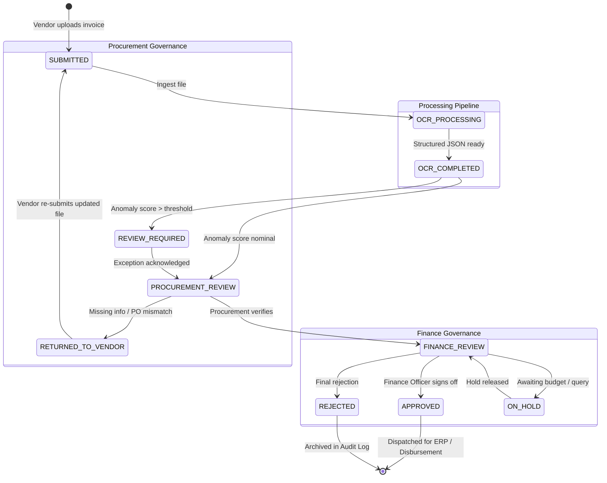

# ⚡ InvoiceFlow
### *Autonomous Multi-Tenant Invoice Intelligence, Risk Forensics & AP Workflow Automation*

[](https://www.typescriptlang.org/)
[](https://react.dev/)
[](https://tanstack.com/)
[](https://tailwindcss.com/)
[](https://nodejs.org/)
[](https://expressjs.com/)
[](https://www.mongodb.com/)
[](#ai--extraction-pipeline)
[](LICENSE)

---

## 📑 Table of Contents

- [1. Executive Summary](#1-executive-summary)
- [2. The Enterprise Challenge](#2-the-enterprise-challenge)
- [3. Industry Applications (0 to Enterprise)](#3-industry-applications-0-to-enterprise)
  - [Manufacturing & Supply Chain](#-manufacturing--automotive--heavy-industry)
  - [Retail, E-Commerce & FMCG](#-retail-e-commerce--fmcg)
  - [Healthcare, Biotech & Pharmaceuticals](#-healthcare-hospitals--pharmaceuticals)
  - [IT, SaaS & Professional Services](#-it-enterprises-saas--consulting)
  - [Construction, Real Estate & Infrastructure](#-construction-engineering--real-estate)
  - [Logistics, Shipping & Freight](#-logistics-3pl--freight-forwarding)
- [4. Core Platform Capabilities](#4-core-platform-capabilities)
  - [Multi-Engine AI Extraction Pipeline](#multi-engine-ai-extraction-pipeline)
  - [Real-Time Anomaly & Fraud Detection Engine](#real-time-anomaly--fraud-detection-engine)
  - [End-to-End Multi-Party Workflow](#end-to-end-multi-party-workflow)
  - [Multi-Tenant Data Isolation & Security](#multi-tenant-data-isolation--security)
  - [Tamper-Evident Audit & Compliance Logging](#tamper-evident-audit--compliance-logging)
- [5. System Architecture & Data Flow](#5-system-architecture--data-flow)
- [6. Role-Based Access Control (RBAC) Matrix](#6-role-based-access-control-rbac-matrix)
- [7. Comprehensive Workflow State Machine](#7-comprehensive-workflow-state-machine)
- [8. Anomaly Rules & Heuristics Catalogue](#8-anomaly-rules--heuristics-catalogue)
- [9. Tech Stack Overview](#9-tech-stack-overview)
- [10. Quickstart Guide (Zero to Running)](#10-quickstart-guide-zero-to-running)
  - [Prerequisites](#prerequisites)
  - [Repository Setup](#1-repository-setup)
  - [Backend Configuration](#2-backend-configuration)
  - [Frontend Configuration](#3-frontend-configuration)
  - [Running the System](#4-running-the-system)
  - [Demo Accounts & Seeding](#5-demo-accounts--seeding)
- [11. API Reference Guide](#11-api-reference-guide)
- [12. Testing & Quality Assurance](#12-testing--quality-assurance)
- [13. Production Hardening & Deployment](#13-production-hardening--deployment)
- [14. License](#14-license)

---

## 1. Executive Summary

**InvoiceFlow** is an enterprise-grade, multi-tenant Accounts Payable (AP) automation and invoice risk intelligence platform. It bridges the critical divide between **Suppliers/Vendors**, **Procurement Officers**, and **Finance Executives**. 

Powered by a hybrid OCR and Large Language Model (LLM) extraction pipeline, InvoiceFlow converts unstructured PDF and image invoices into fully reconciled structured data, evaluates them against a 10-rule forensic anomaly detection engine, and routes them through a strict, auditable multi-tier governance workflow before ERP disbursement.

```
       [ Vendor Portal ]
       Upload PDF / Image
              │
              ▼
  ┌───────────────────────┐
  │  Hybrid AI Extraction │ ◄── OCR.space / Gemini / Groq / Ollama
  └───────────┬───────────┘
              ▼
  ┌───────────────────────┐
  │ Forensic Risk Engine  │ ◄── 10 Anomaly Heuristics (0-100 Score)
  └───────────┬───────────┘
              ▼
 ┌─────────────────────────┐
 │ 2-Step Approval Engine  │
 │  1. Procurement Verify  │ ──► Rejection / Return to Vendor
 │  2. Finance Final Review│ ──► Multi-currency Approval
 └────────────┬────────────┘
              ▼
  [ Tamper-Evident Audit & ERP Ready ]
```

---

## 2. The Enterprise Challenge

In traditional corporate accounting, Accounts Payable remains one of the most error-prone and vulnerable operational vectors:

1. **Manual Data Entry Bottlenecks**: High-volume invoice processing wastes thousands of human hours on manual keying, with error rates averaging 3–5%.
2. **Duplicate & Split Payments**: Duplicate invoices and "split billing" (submitting micro-invoices just below management sign-off thresholds) drain 1–3% of total enterprise spend annually.
3. **Ghost Vendors & Compliance Fines**: Mismatched GSTIN/tax IDs and unverified bank details expose corporations to regulatory tax penalties, GST input credit disqualification, and payment diversion fraud.
4. **Disjointed Communication**: Endless email threads between vendors, purchasing agents, and treasury result in late-payment penalties, missed early-bird discounts, and poor supplier relationships.
5. **Audit Nightmare**: Disconnected spreadsheets and paper receipts lack an unalterable chain of custody, creating severe compliance liabilities under SOX, GST, and IFRS.

**InvoiceFlow addresses all 5 challenges natively out of the box.**

---

## 3. Industry Applications (0 to Enterprise)

InvoiceFlow is architected with complete organizational tenancy and configurable workflows, enabling frictionless deployment across any industry vertical:

### 🏭 Manufacturing, Automotive & Heavy Industry
- **Challenge**: Thousands of monthly invoices with complex bill-of-materials (BOM), multiple job works, freight surcharges, and fluctuating material unit rates.
- **InvoiceFlow Solution**:
  - **Line-Item 3-Way Match**: Verifies PO numbers, line descriptions, quantities, and unit prices directly against goods receipt notes (GRN).
  - **Tolerance Thresholds**: Flags quantity discrepancies and price variations exceeding pre-configured tolerance limits.
  - **Vendor Performance Tracking**: Monitors supplier delivery timelines and billing reliability scores.

### 🛒 Retail, E-Commerce & FMCG
- **Challenge**: Rapid supplier turnover, seasonal inventory spikes, and massive invoice volume across distributed retail distribution centers.
- **InvoiceFlow Solution**:
  - **Duplicate Prevention**: Detects duplicate invoices submitted across different distribution centers via SHA-256 file hashing and fuzzy invoice number normalization.
  - **Split-Invoice Detection**: Flags instances where vendors submit split invoices within 24–48 hours to bypass approval tiers.
  - **GSTIN & Tax Cross-Verification**: Validates vendor tax IDs and automatically checks mathematical accuracy across CGST, SGST, and IGST totals.

### 🏥 Healthcare, Hospitals & Pharmaceuticals
- **Challenge**: Strict regulatory oversight (21 CFR Part 11, HIPAA compliance), batch number reconciliation, and time-critical medical supplies intake.
- **InvoiceFlow Solution**:
  - **Tamper-Evident Audit Trails**: Every document view, verification step, and approval generates a tamper-evident audit log with exact timestamps, IP provenance, and user identities.
  - **Expiry & Batch Verification**: Extracts and registers lot numbers and expiry dates to prevent acceptance of expired healthcare inventory.
  - **Departmental Segregation**: Multi-tenant permissions prevent oncology, surgical, and general procurement units from seeing unauthorized financial records.

### 💻 IT Enterprises, SaaS & Consulting
- **Challenge**: Global multi-currency disbursements, recurring cloud subscriptions, contractor hourly retainers, and cross-border vendor withholding taxes.
- **InvoiceFlow Solution**:
  - **Multi-Currency Reconciliation**: Automatically normalizes USD, EUR, GBP, and INR line items with currency detection.
  - **Automated Expense Categorization**: LLM-driven categorization classifies invoices into proper General Ledger (GL) accounts (e.g., *Cloud Infrastructure*, *Professional Services*, *Software Licenses*).
  - **Contractor Timesheet Matching**: Links hourly rates against active master service agreements (MSAs).

### 🏗️ Construction, Engineering & Real Estate
- **Challenge**: Multi-stage milestone billing, retention money holdbacks, subcontractor work verifications, and fluctuating equipment rentals.
- **InvoiceFlow Solution**:
  - **Stage-Gate Review**: Procurement officers review proof-of-work attachments alongside the invoice before routing to Finance.
  - **Hold & Return Lifecycle**: Directly "Return to Vendor" with line-item rejection notes, enabling subcontractors to adjust retainage and re-submit in one click without restarting the entire cycle.
  - **Equipment & Daily Rate Auditing**: Flags weekend billing anomalies and suspicious flat-rate round numbers.

### 🚚 Logistics, 3PL & Freight Forwarding
- **Challenge**: Complex tariff structures, detention/demurrage fees, fuel surcharges, and multi-leg billing across regional carriers.
- **InvoiceFlow Solution**:
  - **Unusual Surcharge Detection**: Statistical anomaly detection alerts finance managers when freight or fuel surcharges deviate beyond standard deviations.
  - **Rapid Intake via Batch Upload**: Allows logistics dispatchers to upload hundreds of waybills and freight invoices simultaneously for background OCR extraction.

---

## 4. Core Platform Capabilities

### Multi-Engine AI Extraction Pipeline
InvoiceFlow integrates a resilient, multi-tiered document processing pipeline capable of handling distorted scans, mobile camera captures, and high-fidelity digital PDFs:

1. **Primary OCR Ingestion**: Integrates with **OCR.space** engine for optical character recognition, font handling, and table boundary detection.
2. **LLM Structuring Engine**: Leverages state-of-the-art LLMs via **Google Gemini** (`gemini-3.6-flash`, `gemini-pro`) or **Groq Cloud** (`qwen/qwen3.8-27b`) to convert raw text into strictly validated JSON schemas.
3. **Air-Gapped / Offline Local AI (Ollama)**: For defense contractors, banks, or confidential healthcare facilities, InvoiceFlow supports local, fully private LLMs (e.g., Llama 3, Qwen) served via Ollama with zero internet egress.
4. **Deterministic Fallback Structurer**: If cloud APIs are unreachable, a conservative local regex and NLP text parser executes in-flight, marking ambiguous fields with `confidence: LOW` for human-in-the-loop review.
5. **Field Provenance & Confidence Metrics**: Every extracted field (Vendor Name, GSTIN, Invoice Date, PO Number, Subtotal, Taxes, Total) carries a confidence score (0.00 – 1.00) and byte coordinates.

### Real-Time Anomaly & Fraud Detection Engine
Every invoice passing through InvoiceFlow is scanned by the rules engine before human review. It assigns an aggregated **Risk Score (0–100)** and categorizes risk into **`LOW`**, **`MEDIUM`**, **`HIGH`**, or **`CRITICAL`**.

| Rule | Detection Trigger | Business Defense |
| :--- | :--- | :--- |
| **Duplicate Invoice** | Matches existing invoice number for vendor or matching SHA-256 document checksum. | Stops accidental double-billing and fraudulent double-submission across departments. |
| **Split Invoice (Smurfing)** | Multiple invoices from same vendor within 48h just under review thresholds. | Prevents rogue purchasers and colluding vendors from evading executive approval thresholds. |
| **GSTIN Format & Checksum** | Evaluates tax number format, state code, and Luhn checksum. | Safeguards input tax credit (ITC) and stops tax evasion penalties. |
| **Line-Item Total Mismatch** | Discrepancy between $\sum (\text{Line Items}) + \text{Taxes}$ and Total Amount. | Catches computational manipulation, hidden freight charges, and rounding traps. |
| **Unusual Amount Outlier** | Statistical z-score outlier compared to historic vendor averages. | Alerts treasury to unusually large outflows before funds leave bank accounts. |
| **Suspicious Round Figures** | Large round invoice totals (e.g. exactly $50,000.00 without cents/line-item breakdown). | Statistically correlated with fraudulent, kickback, or non-procured invoices. |
| **Date Anomalies** | Invoice dates in the future, weekend dates for B2B contracts, or stale invoices (>90 days old). | Catches backdated transactions, expired PO allocations, and processing delays. |
| **PO Cross-Match** | PO number missing, invalid, or already fully liquidated. | Enforces disciplined "No PO, No Pay" procurement policies across the company. |
| **Vendor Verification** | Vendor profile inactive, suspended, bank details unverified, or mismatched name. | Eliminates vendor impersonation and phantom vendor shell-company fraud. |
| **Quantity Mismatch** | Invoiced quantities exceed purchase order or goods receipt records. | Prevents paying for goods or services never delivered. |

### End-to-End Multi-Party Workflow
- **Vendor Portal**: Suppliers register, link with enterprise organizations, submit digital invoices with attachments, track review statuses in real-time, and view explicit feedback if returned.
- **Procurement Officer Inbox**: Purchasing teams verify supplier credentials, cross-reference purchase orders, validate line-item specifications, acknowledge or flag exceptions, and forward verified invoices to Finance.
- **Finance Manager Review Desk**: Financial controllers evaluate cash flow impact, inspect anomaly flags and risk scores, view OCR extraction side-by-side with original attachments, and issue final approvals or payment holds.
- **Organization Administrator**: Global oversight across user provisioning, role assignments, department-wide analytics, and audit inspection.

### Multi-Tenant Data Isolation & Security
- **Organization-Scoped Queries**: All database records enforce multi-tenancy at the query level via `organizationId`. Cross-tenant data leakage is structurally impossible.
- **Role-Based Token Isolation**: JWTs encode `userId`, `role`, `organizationId`, and optional `vendorId`. Express middleware validates organization membership on every single route.
- **Cryptographic File Storage**: Invoices and attachments are tagged with SHA-256 fingerprints to ensure zero tampering after submission.
- **Defense-in-Depth Middleware**: Configured with `helmet`, parameterized database queries, strict `zod` payload validation schemas, and enterprise CORS constraints.

### Tamper-Evident Audit & Compliance Logging
Every operation (submission, OCR extraction, procurement return, finance approval, rejection) emits an immutable `AuditLog` entry detailing:
- Actor ID, User Email, and Assigned Role
- Tenant Organization ID
- Action Type (`INVOICE_SUBMITTED`, `PROCUREMENT_VERIFIED`, `FINANCE_APPROVED`, etc.)
- Previous State $\rightarrow$ Next State
- IP Address, User Agent, and Timestamp
- Detailed metadata & rationale (e.g., return reason, exception override comments)

---

## 5. System Architecture & Data Flow

```mermaid
graph TD
    subgraph Clients ["Frontend Client Applications (React 19 + TanStack)"]
        VP[Vendor Portal]
        PO[Procurement Inbox]
        FM[Finance Review Desk]
        OA[Org Admin Console]
    end

    subgraph Gateway ["API Gateway & Security Layer (Express)"]
        AUTH[JWT & Role Verification]
        TENANT[Tenant Isolation Middleware]
        HELMET[Security Headers & CORS]
    end

    subgraph Pipeline ["AI Extraction & Risk Forensics"]
        OCR[OCR Service (OCR.space / Ollama)]
        LLM[Structuring Engine (Gemini / Groq)]
        ANOMALY[Forensic Anomaly Engine (10 Rules)]
        CAT[GL Categorization Module]
    end

    subgraph Workflows ["Core Business Services"]
        VS[Vendor Service]
        IS[Invoice Lifecycle Service]
        PS[Procurement Service]
        FS[Finance Approval Service]
        AS[Tamper-Evident Audit Service]
    end

    subgraph Storage ["Enterprise Persistence (MongoDB)"]
        M_ORG[(Organizations)]
        M_USR[(Users & RBAC)]
        M_VND[(Vendors)]
        M_INV[(Invoices & Attachments)]
        M_AUD[(Audit Logs)]
    end

    VP -->|Upload PDF / Auth| AUTH
    PO -->|Verify / Return| AUTH
    FM -->|Approve / Reject| AUTH
    OA -->|Manage Users| AUTH

    AUTH --> TENANT --> HELMET
    HELMET --> VS & IS & PS & FS

    IS --> OCR --> LLM --> ANOMALY --> CAT
    ANOMALY --> IS
    
    VS & IS & PS & FS --> AS
    VS & IS & PS & FS & AS --> Storage
```

---

## 6. Role-Based Access Control (RBAC) Matrix

| Capability / Action | VENDOR | PROCUREMENT_OFFICER | FINANCE_MANAGER | ORGANIZATION_ADMIN |
| :--- | :---: | :---: | :---: | :---: |
| **Search & Connect with Organizations** | ✅ | ❌ | ❌ | ❌ |
| **Submit New Invoice (PDF / Image)** | ✅ | ✅ | ❌ | ✅ |
| **View Own Submitted Invoices** | ✅ | ✅ | ✅ | ✅ |
| **View Organization Invoices** | ❌ (Own only) | ✅ (Org only) | ✅ (Org only) | ✅ (Org wide) |
| **Procurement Queue Inspection** | ❌ | ✅ | ❌ | ✅ |
| **Verify Invoice to Finance Review** | ❌ | ✅ | ❌ | ✅ |
| **Return Invoice to Vendor with Notes**| ❌ | ✅ | ❌ | ✅ |
| **Finance Approval Queue** | ❌ | ❌ | ✅ | ✅ |
| **Final Approve / Reject Invoice** | ❌ | ❌ | ✅ | ✅ |
| **View Anomaly Detection Details** | ❌ | ✅ (Limited) | ✅ (Full Forensics)| ✅ (Full Forensics)|
| **Acknowledge Risk Exceptions** | ❌ | ✅ | ✅ | ✅ |
| **Access System Audit Logs** | ❌ | ❌ | ✅ | ✅ |
| **User & Tenant Management** | ❌ | ❌ | ❌ | ✅ |

---

## 7. Comprehensive Workflow State Machine



---

## 8. Anomaly Rules & Heuristics Catalogue

The anomaly detection engine runs asynchronously upon extraction completion, assigning granular severity levels:

```typescript
// Anomaly Rule Severity Hierarchy
export type RiskLevel = "LOW" | "MEDIUM" | "HIGH" | "CRITICAL";
```

1. **`duplicateInvoice`**: Calculates cryptographic SHA-256 document hashes and runs an index-accelerated query against `organizationId + vendorId + invoiceNumber`. Prevents duplicate disbursements.
2. **`splitInvoice`**: Analyzes the preceding 48 hours of invoices for the same vendor. If multiple invoices cluster within 5% below approval thresholds, a `CRITICAL` alert triggers.
3. **`gstin`**: Evaluates 15-character GSTIN tax codes (2-digit state code, 10-digit PAN, entity digit, checksum). Flags invalid or mismatched GSTINs.
4. **`amountMismatch`**: Verifies:
   $$\text{Total} = \text{Subtotal} + \text{Tax Amount} + \text{Shipping} - \text{Discount} \pm 0.01$$
5. **`unusualAmount`**: Computes standard deviation and z-score metrics across the vendor's trailing 90-day billing history. Invoices exceeding $3\sigma$ are flagged.
6. **`roundAmount`**: Uses modulo heuristics for round totals $\ge \$10,000$ without fractional cents or valid PO documentation.
7. **`dateAnomaly`**: 
   - Future Invoice Date (greater than current system timestamp + 24 hours buffer)
   - Stale Invoice (> 90 days past issuance)
   - Weekend billing on standard weekday delivery terms
8. **`poNotFound`**: Flags invoices with missing purchase order references when the organization mandates PO-backed procurement.
9. **`quantityMismatch`**: Compares line-item invoiced quantities against verified Goods Received Notes (GRN).
10. **`vendorVerification`**: Ensures the vendor is registered, active, approved in the organization, and that bank details match records.

---

## 9. Tech Stack Overview

### Frontend Architecture
- **Framework**: [React 19](https://react.dev/) (Strict Mode)
- **Routing & SSR**: [TanStack Start](https://tanstack.com/start) & [TanStack Router](https://tanstack.com/router) with strict type-safe routes
- **Server State Management**: [TanStack React Query v5](https://tanstack.com/query) with optimistic updates
- **Styling**: [Tailwind CSS v4](https://tailwindcss.com/) with custom design tokens
- **UI Primitives**: [Radix UI](https://www.radix-ui.com/) accessible primitives (Dialogs, Menus, Popovers, Tabs, Tooltips)
- **Visual Analytics**: [Recharts](https://recharts.org/) for risk distribution, spend analytics, and cycle time curves
- **Icons & Polish**: [Lucide React](https://lucide.dev/), Sonner toast notifications, vaul drawers
- **Build Tool**: [Vite 8](https://vitejs.dev/) with high-speed HMR

### Backend Architecture
- **Runtime & Language**: [Node.js 20+](https://nodejs.org/) & [TypeScript 5.8](https://www.typescriptlang.org/)
- **API Framework**: [Express 4.19](https://expressjs.com/) with modular route architecture
- **Database Engine**: [MongoDB](https://www.mongodb.com/) via [Mongoose 8](https://mongoosejs.com/)
- **Security**: [Helmet](https://helmetjs.github.io/), [bcrypt](https://www.npmjs.com/package/bcrypt), [jsonwebtoken](https://github.com/auth0/node-jsonwebtoken)
- **File Handling**: [Multer](https://github.com/expressjs/multer) with memory streaming and SHA-256 hashing
- **Validation**: [Zod 3.23](https://zod.dev/) schema enforcement
- **Test Runner**: [TSX](https://github.com/privatenumber/tsx) native TypeScript runner

### AI & OCR Pipeline Providers
- **OCR Engine**: [OCR.space REST API](https://ocr.space/ocrapi)
- **Cloud LLM Structuring**: [Google Gemini](https://ai.google.dev/) (`gemini-3.6-flash`, `gemini-pro`) & [Groq Cloud](https://groq.com/) (`qwen/qwen3.8-27b`)
- **Local / Air-Gapped AI**: [Ollama](https://ollama.com/) local inference support

---

## 10. Quickstart Guide (Zero to Running)

### Prerequisites
- **Node.js**: v20.0.0 or higher ([Download Node.js](https://nodejs.org/))
- **Package Manager**: `npm` (v10+), `pnpm` (v9+), or `bun`
- **Database**: MongoDB running locally on `mongodb://localhost:27017` or a [MongoDB Atlas](https://www.mongodb.com/cloud/atlas) URI

---

### 1. Repository Setup

Clone the repository and enter the directory:

```bash
git clone https://github.com/your-org/invoiceflow.git
cd invoiceflow
```

Install root and frontend dependencies:

```bash
npm install
```

Install backend dependencies:

```bash
cd backend
npm install
cd ..
```

---

### 2. Backend Configuration

Create the backend environment file:

```bash
cp backend/.env.example backend/.env
```

Open `backend/.env` and configure your environment variables:

```ini
# ============================================================================
# SERVER CONFIGURATION
# ============================================================================
NODE_ENV=development
PORT=5000

# ============================================================================
# DATABASE CONFIGURATION (MONGODB)
# ============================================================================
DATABASE_URL=mongodb://localhost:27017/InvoiceFlow

# ============================================================================
# AUTHENTICATION (JWT) - Minimum 32 characters in production
# ============================================================================
JWT_SECRET=supersecret-dev-jwt-key-not-for-production-min32chars

# ============================================================================
# CORS CONFIGURATION
# ============================================================================
CORS_ORIGIN=http://localhost:5173

# ============================================================================
# AI & OCR EXTRACTION PROVIDERS
# ============================================================================
EXTRACTION_PROVIDER=ocr_space
OCR_SPACE_API_KEY=your_ocr_space_api_key_here
OCR_SPACE_ENDPOINT=https://api.ocr.space/parse/image

# Cloud Structuring Engine (Gemini / Groq)
PRIMARY_STRUCTURER=groq
GROQ_API_KEY=your_groq_api_key_here
GROQ_EXTRACTION_MODEL=qwen/qwen3.8-27b

# (Optional) Google Gemini Configuration
GEMINI_API_KEY=your_gemini_api_key_here
GEMINI_EXTRACTION_MODEL=gemini-3.6-flash
GEMINI_CATEGORIZATION_MODEL=gemini-pro

# (Optional) Local Offline Ollama Configuration
# EXTRACTION_PROVIDER=ollama
# OLLAMA_URL=http://localhost:11434
# OLLAMA_MODEL=llama3
```

---

### 3. Frontend Configuration

Create your frontend environment configuration:

```bash
# In the repository root
cat << EOF > frontend/.env.local
VITE_API_URL=http://localhost:5000/api
EOF
```

---

### 4. Running the System

Start the application services in development mode:

#### Terminal 1 — Backend API:
```bash
cd backend
npm run dev
```
*The API initializes on `http://localhost:5000` with MongoDB connected.*

#### Terminal 2 — Frontend Application:
```bash
# From repository root
npm run dev
```
*The frontend interface launches on `http://localhost:5173`.*

---

### 5. Demo Accounts & Seeding

InvoiceFlow includes an integrated database seeder for testing organizational multi-tenancy and the complete invoice lifecycle out of the box.

Run the seed script:
```bash
cd backend
npm run seed
```

#### Pre-configured Test Accounts:

| Role | Email | Password | Scope / Permissions |
| :--- | :--- | :--- | :--- |
| **Vendor** | `vendor@zenithsupplies.com` | `Password123!` | Submits invoices, tracks payments, views feedback |
| **Procurement Officer**| `procurement@genesys-corp.com` | `Password123!` | Verifies supplier invoices, handles PO matching |
| **Finance Manager** | `finance@genesys-corp.com` | `Password123!` | Approves payouts, analyzes risk, releases payments |
| **Organization Admin** | `admin@genesys-corp.com` | `Password123!` | Full tenant administration & user management |

---

## 11. API Reference Guide

### Base URL: `/api` (or `/api/v1`)

#### Authentication & User Management
- `POST /api/auth/register` — Register a new enterprise user.
- `POST /api/auth/login` — Authenticate and receive a tenant-scoped JWT token.
- `GET /api/auth/me` — Retrieve the current user's authenticated profile.

#### Organization Management
- `GET /api/organizations` — List active organizations.
- `GET /api/organizations/search?q=Query` — Search organizations by name or GSTIN.
- `POST /api/organizations` — Create an enterprise organization.
- `GET /api/organizations/:id` — Retrieve organization details and assigned officers.

#### Vendor Operations
- `POST /api/vendor/register` — Onboard a new vendor with tax & banking details.
- `GET /api/vendor/profile` — Fetch the authenticated vendor's profile.
- `POST /api/vendor/organizations/select` — Link vendor with an enterprise tenant.
- `GET /api/vendor/organizations` — List all organizations the vendor is linked with.
- `POST /api/vendor/invoices` — Submit invoice with multipart file upload (`attachment`).
- `GET /api/vendor/invoices` — Retrieve paginated list of vendor's submitted invoices.
- `GET /api/vendor/invoices/:id` — Get real-time status and line-item breakdown for an invoice.

#### Procurement Workflow
- `GET /api/invoices/procurement/pending` — Fetch invoices queued for procurement review.
- `POST /api/invoices/:id/procurement/verify` — Verify invoice specifications and route to Finance.
- `POST /api/invoices/:id/procurement/return` — Return invoice to vendor with mandatory reason notes.

#### Finance & Approvals
- `GET /api/finance/review` — Fetch queue of invoices awaiting financial approval.
- `POST /api/finance/invoices/:id/approve` — Approve invoice for disbursement.
- `POST /api/finance/invoices/:id/reject` — Issue final rejection with audit justification.
- `POST /api/finance/invoices/:id/hold` — Place invoice on payment hold.

#### Forensic Risk & Audit
- `GET /api/anomaly/:invoiceId` — Get comprehensive risk analysis and detected anomalies.
- `GET /api/audit/:invoiceId` — Retrieve tamper-evident chronological audit logs.
- `GET /api/health` — Platform health check and status inspection.

---

## 12. Testing & Quality Assurance

InvoiceFlow is backed by a comprehensive regression and validation test suite:

```bash
cd backend
npm test
```

### Test Suite Coverage:
- **Release Candidate Validation**: `release-candidate.validation.test.ts`
- **Multi-Tenant Security & Isolation**: `security.regression.test.ts`
- **Tenant Management**: `phase2.organization.test.ts`
- **Vendor Workflow**: `phase3.vendor.test.ts`
- **Forensic Anomaly Engine**: `anomaly.test.ts`
- **Invoice Lifecycle Engine**: `invoice.test.ts` & `invoice.routes.test.ts`
- **OCR & Document Extraction**: `extraction.test.ts` & `ocrSpaceProvider.test.ts`
- **LLM Structuring**: `geminiTextStructurer.test.ts`
- **GL Categorization**: `categorization.test.ts`

Run TypeScript static verification without emit:
```bash
# Frontend typecheck
npm run typecheck

# Backend typecheck
cd backend && npm run typecheck
```

---

## 13. Production Hardening & Deployment

When deploying InvoiceFlow to enterprise cloud environments (AWS, GCP, Azure, Render, Docker):

1. **Enforce Strong Secrets**: Generate a cryptographic JWT secret of at least 64 characters:
   ```bash
   node -e "console.log(require('crypto').randomBytes(32).toString('hex'))"
   ```
2. **Restrict CORS**: Set `CORS_ORIGIN` strictly to your production domain (e.g. `https://invoices.yourcompany.com`).
3. **Database Security**:
   - Enable MongoDB TLS/SSL connections.
   - Utilize a dedicated database user with least-privilege credentials.
   - Ensure the compound unique index on `{ organizationId: 1, invoiceNumber: 1 }` is enabled for fast deduplication.
4. **File Storage**: In production, swap local/in-memory attachment buffers to private Amazon S3, Google Cloud Storage, or Azure Blob Storage buckets with pre-signed ephemeral URLs.
5. **Reverse Proxy & Rate Limiting**: Deploy behind NGINX or Cloudflare with rate limiting on `/api/auth/*` and `/api/vendor/invoices` to prevent brute-force and resource exhaustion attacks.

---

## 14. License

This project is licensed under the **MIT License**. See the [LICENSE](LICENSE) file for complete details.

---

<p align="center">
  <b>Built for modern enterprises by the InvoiceFlow Engineering Team.</b>
</p>
