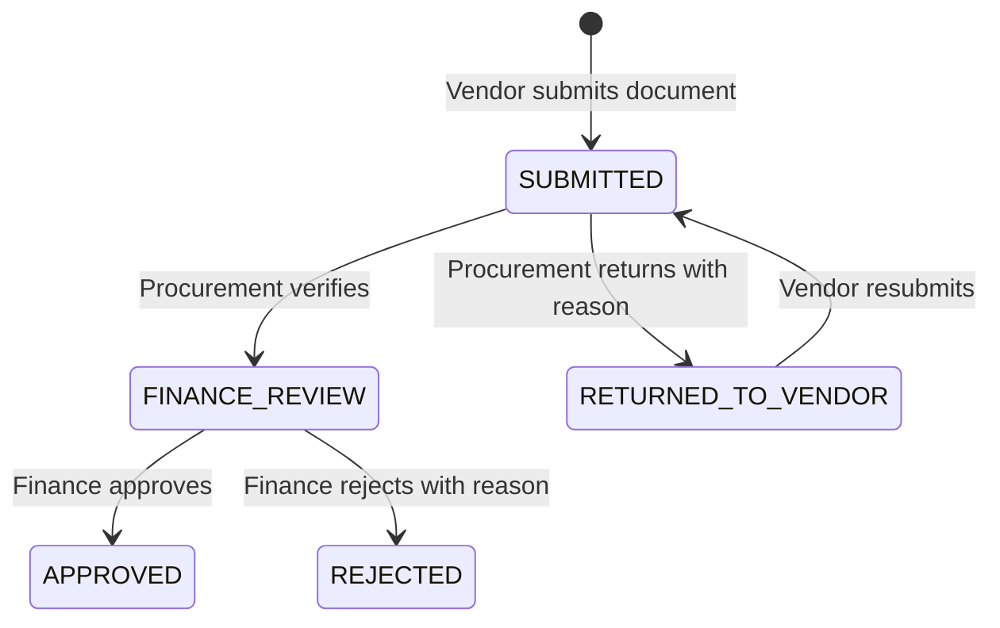

# Connected Invoice Workflow

## Current Contract

The connected workflow uses the existing MongoDB `Invoice` model for the Vendor -> Procurement -> Finance path. Procurement is the existing Resource Manager role: `PROCUREMENT_OFFICER`.

The existing `InvoiceDocument` extraction pipeline remains available for the document-processing workflow. The legacy `Invoice` model is the connected vendor/finance workflow model and now records attachment bytes, procurement decision metadata, and the explicit finance-review state.

## Role Matrix

| Role | Vendor records | Procurement inbox | Procurement transition | Finance queue | Finance decision |
| --- | --- | --- | --- | --- | --- |
| `VENDOR` | Own invoices only | No | No | No | No |
| `PROCUREMENT_OFFICER` | Organization invoices | Yes | Verify or return | No | No |
| `FINANCE_MANAGER` | Organization invoices | No | No | `FINANCE_REVIEW` only | Approve or reject |
| `ORGANIZATION_ADMIN` | Organization scope | Yes | Verify or return | Organization scope | Existing admin approval path |

## API Changes

Existing endpoints reused:

- `POST /api/vendor/invoices`
- `GET /api/vendor/invoices`
- `GET /api/vendor/profile`
- `GET /api/finance/review`
- `POST /api/finance/invoices/:id/approve`
- `POST /api/finance/invoices/:id/reject`

Connected workflow endpoints added:

- `GET /api/invoices/procurement/pending`
- `POST /api/invoices/:id/procurement/verify`
- `POST /api/invoices/:id/procurement/return`

Procurement transitions are conditional MongoDB updates scoped by organization and current status. Finance approval and rejection now accept only `FINANCE_REVIEW`, preventing Finance from bypassing Procurement.

## Validation

- Backend production build: passed (`pnpm build`).
- Backend direct TypeScript check: passed (`pnpm exec tsc --noEmit`).
- Frontend diagnostics: no errors reported for the touched workflow files.
- Frontend production build: passed (`pnpm build`).
- Release-candidate MongoDB validation: passed all 9 checks.
- Full backend test script: not green. `phase3.vendor.test.ts` has fixture/setup failures that leave later vendor assertions without a created invoice; the existing test fixture needs repair before the full suite can be claimed green.
- Full browser workflow execution: not run to completion in this environment because the authenticated Vendor, Procurement, and Finance browser sessions were not all available simultaneously.

## Remaining Limitations

- The role-only demo selector is not a security boundary. Production workflow operations must use the existing JWT authentication path.
- Vendor demo mode can display the seeded demo organization and show a local success state without a token; durable upload and workflow transitions require an authenticated Vendor JWT.
- Browser-driven end-to-end evidence still requires MongoDB, seeded accounts, backend startup, and a browser session logged into separate Vendor, Procurement, and Finance accounts.